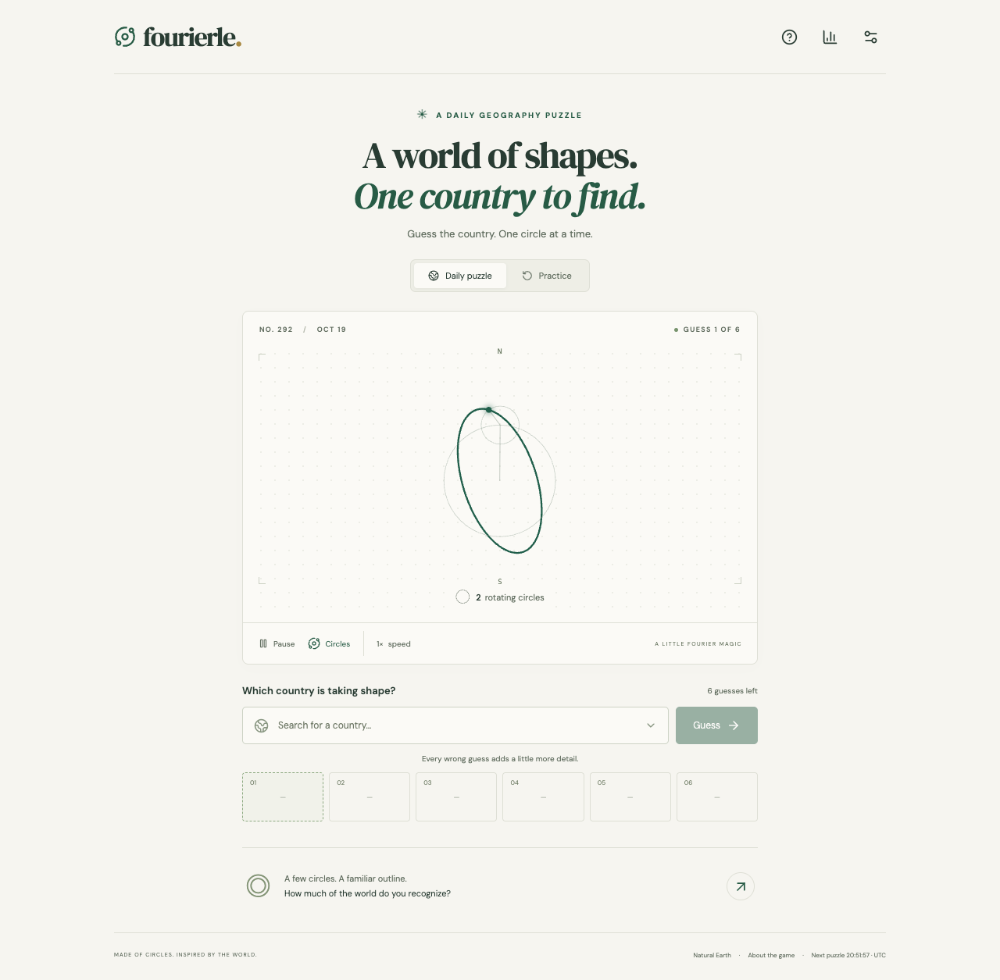

# Fourierle

**Guess the country. One circle at a time.** A complete browser-local daily geography game with real, animated complex Fourier series. Six guesses reveal increasingly detailed boundaries. No distances, compass hints, authentication, database, paid API, or daily admin task.



## Play and develop

Requires Node.js 22.12+ (24 recommended). Python is needed only to regenerate geography.

```sh
npm ci
npm run dev
# http://127.0.0.1:5173
```

Daily and unlimited practice modes include Easy and Hard difficulty, keyboard country search and aliases, animated independent island chains, pause/circle/speed controls, dark appearance, reduced-motion support, browser-local progress, daily statistics and historical results, UTC countdown/reset, spoiler-free sharing, and a post-game coefficient explorer. All fonts and country geometry are served locally. Only the country index and the active country's geometry are fetched during normal play.

The visual design uses React 19, TypeScript, Vite, Canvas 2D, Lucide icons and locally bundled DM Sans/DM Serif Display. Plain CSS keeps this compact application simple; Tailwind was not needed. Python, NumPy and Shapely handle preprocessing. Runtime Python and GIS libraries are not required by the website.

## Commands

| Command                                    | Purpose                                                       |
| ------------------------------------------ | ------------------------------------------------------------- |
| `npm run dev`                              | Local app and development-only calibration lab at `/?lab`     |
| `npm test`                                 | Vitest engine, schedule and React interaction tests           |
| `npm run test:e2e`                         | Playwright desktop Chrome, mobile Chrome and mobile WebKit    |
| `npm run test:all-countries`               | Render all six stages for every country and check every asset |
| `npm run schedule`                         | Regenerate schedule manifest and validate 100 years           |
| `npm run build`                            | Type-check and create deployable `dist/`                      |
| `npm run preview`                          | Serve the production build locally                            |
| `python3 scripts/download.py`              | Download pinned Natural Earth source                          |
| `npm run data` / `npm run calibrate`       | Regenerate geometry, coefficients and all metrics             |
| `.venv/bin/pytest scripts/test_math.py -q` | Mathematical and full-pool invariants                         |
| `node scripts/visual-review.mjs`           | Capture 20 countries at all six stages (dev server required)  |

For data regeneration:

```sh
python3 -m venv .venv
.venv/bin/pip install -r requirements.txt
npm run data
```

For browser tests on Linux, run `npx playwright install --with-deps chromium webkit`. On macOS the default configuration uses installed Google Chrome plus Playwright WebKit; run `npx playwright install webkit`, or set `CHROME_PATH` to another Chromium executable. The suite starts a local dev server if one is not running. To verify the production bundle, run `npm run build` then `E2E_PRODUCTION=1 npm run test:e2e`. GitHub Actions executes the complete test/build workflow on every push and pull request.

## Genuine Fourier reconstruction

Every retained exterior boundary is projected to a local equirectangular plane: longitude is scaled by cosine of the country's reference latitude, with north kept up. The longitude seam lies in the largest empty longitude gap, so antimeridian islands stay adjacent. All polygons share one translation and scale, preserving their relative location and geographical proportions. No artificial lines join islands.

Each closed ring is resampled at 512 equal arc-length positions, represented as complex values `z[k] = x[k] + i y[k]`. NumPy computes `c[n] = FFT(z)[n] / 512`. The browser draws

`z_N(t) = c[0] + Σ(n in S_N) c[n] exp(i n t)`.

Each nonzero-frequency term is a circle with radius `abs(c[n])`, phase `arg(c[n])`, and signed angular speed `n`. Positive and negative frequencies rotate in opposite directions. The constant coefficient is a stationary center, never counted as a circle. Every island has an independent chain. **Circle counts are totals across all chains.** A small island can first appear at a later stage, when a term is allocated to it.

Partial-sum paths are calculated once per stage; only the epicycle endpoints are updated per animation frame. The complete approximation is visible immediately. `requestAnimationFrame` runs outside React's render cycle, skips drawing in hidden tabs, cleans up on unmount, and uses a capped device pixel ratio. Resizing keeps one common geographical scale. A short brighter trace follows each moving tip.

## Difficulty calibration and fidelity

`scripts/process.py` compares magnitude-ranked coefficients with paired low-frequency ordering at the same budget. Magnitude ranking minimizes sampled L2 error. The chosen nested order can promote a useful non-elliptical harmonic into the second position when its amplitude is at least 15% of the largest and its aspect ratio remains within 0.6–1.67 times the source aspect. This avoids turning a narrow country such as Chile into a broad triangle. All previously revealed coefficients remain present.

The first five budgets are 2, 4, 8, 16, 32 total circles. The sixth starts at 128 and doubles as needed, up to 1,024 (or all 511 terms for a single-chain country). The choice requires both 99.9% sampled fidelity and a sampled boundary distance no greater than 0.001 normalized units where possible. Every retained island receives at least one term by the final round. One normalized unit is the larger dimension of the entire country. If the final Fourier curve remains more than 0.001 units from the detailed source outline, the game shows that outline while the real epicycles continue animating; the caption says “exact source outline.” The explorer always displays the actual Fourier partial sum and optionally overlays the exact outline with a dashed line.

Two metrics must not be confused:

- **Sampled fidelity:** `1 - max(per-chain RMS point error)` in normalized coordinates; 99.9% means RMS error no greater than 0.001.
- **Source boundary distance:** symmetric Hausdorff distance against the retained, projected Natural Earth exterior rings. The exact fallback renders those rings directly, so its error against that reference is zero apart from six-decimal serialization.

The report also contains aggregate RMS error, relative silhouette area error, aspect ratio error, retained polygon area, coefficient-strategy comparisons, and three similar coarse country signatures. Sampled L2 error decreases monotonically with nested orthogonal coefficient additions; area, Hausdorff distance and human recognizability need not.

The early-shape heuristic compares orientation-preserving normalized extents and low-frequency amplitude signatures. It flags ambiguous puzzles for review, **not** proven difficulty. 47 current countries carry review flags. Visual review covers all 189 final outlines, with closer review of small and island-heavy countries. Genuine two-term outlines remain ambiguous, especially circular countries and island groups. Median solve targets and numerical difficulty ratings require real player testing; no invented difficulty score is shown.

Open `/?lab` in development to inspect any country at all six levels with its metrics and neighbors. The route is disabled in production. Edit `scripts/overrides.json` to set geographical focus bounds or five custom increasing stage budgets, then regenerate and inspect. See [calibration notes](docs/calibration.md).

## Daily schedule: no repeats, forever

Schedule **v1** starts at **2026-01-01 00:00:00 UTC**. `src/pool.json` freezes the 189 stable Natural Earth country IDs. An explicitly implemented xorshift32/Fisher–Yates shuffle, seeded with `0x464f5552`, produces a fixed cycle. The country is `cycle[UTC_day mod 189]`, including well-defined modulo handling before the epoch.

This simpler alternative to long rolling-exclusion blocks provides a mathematical guarantee: every country reappears exactly 189 days later, so no 100-day window can repeat one, including cycle boundaries. It needs no cron, server, new schedule files, or network time API. `source/schedule-v1.json` records the cycle and a 36,525-day validation horizon; the proof works indefinitely.

**Do not reorder/change the v1 pool, shuffle, seed, or epoch.** The preprocessing script rejects eligibility changes against the frozen pool. A future v2 needs a UTC activation date, must retain v1 for all earlier days, and must validate its first 100 days against the v1 tail. Dataset/border changes should likewise be consciously versioned. The initial release uses a repeating shuffled cycle, so the sequence is predictable to someone inspecting source; it is not an anti-cheat system.

The browser checks the UTC day every second and on visibility changes, and checks again before accepting a guess. Device clocks determine UTC; a badly set clock can show the wrong day. A shared accurate clock cannot be guaranteed without a server.

## Persistence and statistics

`localStorage['fourierle-v1']` contains a versioned map of daily games. IDs, uniqueness, guess limits, day/answer consistency and legal transitions are validated on load; malformed entries are ignored. Outcomes are reconstructed from guesses rather than trusting stored status. Storage failures show a visible warning and leave the current page playable.

Statistics are derived from one record per completed day, preventing refresh double-counting. Incomplete days do not count as completed games. Wins on consecutive UTC days form a streak; a missed day or loss breaks it. Today's unplayed/incomplete game allows yesterday's streak to remain active until the UTC deadline. Practice games, wins/losses and a 20-country recent list are separate `sessionStorage` state, surviving refreshes in the same tab. Other tabs synchronize through storage events, and submissions re-read daily storage to avoid ordinary stale-tab overwrites; simultaneous writes across tabs are not transactional.

The share button uses Web Share where available, then clipboard; a selectable spoiler-free text field provides a manual fallback. URLs come from the current deployed origin, never a hardcoded domain. No geographical answer appears in share text.

## Geography and licenses

- Natural Earth **v5.1.2**, 1:10m admin-0 countries, [public domain](https://www.naturalearthdata.com/about/terms-of-use/).
- Pinned [upstream GeoJSON](https://github.com/nvkelso/natural-earth-vector/blob/v5.1.2/geojson/ne_10m_admin_0_countries.geojson), checked in under `source/`. Exact SHA-256 and processing metadata are in `source/manifest.json`. The earlier 1:50m source remains in `source/` for comparison.
- Source code retains this repository's MIT license. DM Sans and DM Serif Display use SIL Open Font License 1.1; packages include their license files. Lucide uses ISC.

The playable pool contains 189 countries, including Taiwan and Palestine. Separately mapped Northern Cyprus and Somaliland are merged into Cyprus and Somalia for this game; boundaries are a cartographic reference, not a political assertion. Vatican City lacks a useful outline at this scale. Kiribati, Micronesia, Marshall Islands, Palau, Tonga and Maldives are excluded because ocean-spanning geometry made their islands unreadably small at the common scale.

Per-country focus rules use contiguous US, metropolitan France, mainland Norway, main-island New Zealand, European Netherlands and continental Portugal. Mainland Ecuador, the main island of Mauritius and central Seychelles now have readable focus regions; their omitted outlying islands are disclosed in the geometry notes. Other polygons are sorted by projected area and retained until 99.5% coverage or 160 polygons, whichever comes first. Borders are simplified by at most roughly a quarter of a display pixel. Lakes and other interior holes are omitted; retained exterior coastlines are reconstructed. The coverage metric refers to the chosen focus region, not all sovereign territory. The current 189-country pool meets at least 99.5% retained exterior area for every country. This is a general-purpose 1:10m outline game, not an authoritative border map.

## Deployment

The build is completely static. No environment variables, secrets or backend are needed.

- **Render (live):** [fourierle.onrender.com](https://fourierle.onrender.com) builds `main` after GitHub checks pass with `npm ci && npm run build` and publishes `dist`. Its response headers are configured in the Render Dashboard; `public/_headers` does not configure Render. Missing paths serve the branded `404.html` with a real 404 status.
- **Vercel:** import this GitHub repository; use `npm run build`, output `dist`. `vercel.json` supplies the settings and baseline response headers.
- **Cloudflare Pages:** connect the repository, Node 24, build `npm run build`, output `dist`. `public/_headers` is copied into the build. Avoid stale caching of `/data`; JS/CSS/font assets are hashed.
- **Sites:** `.openai/hosting.json` binds the private hosted preview and declares `dist` as static output. Sites source sync is separate from this repository's GitHub `origin`.

No rewrite is necessary: the app uses one document and in-memory mode navigation. Serve over HTTPS for clipboard/Web Share support. The app itself requires no login; the private Sites preview has a hosting access gate. A public Vercel/Cloudflare deployment does not need that gate. The static build includes privacy, accessibility, credits, robots/sitemap, and portable 404/500 pages. See the [launch review](docs/launch-readiness.md) for legal and operational caveats.

## Validation and remaining limits

The automated suite includes DFT/negative-frequency correctness, epicycle endpoint sums, arc-length sampling, antimeridian/separate polygon normalization, nested error monotonicity across all countries, final fidelity/fallback, 100 years of scheduling, calendar boundaries, aliases, legal game transitions, storage corruption, streaks, deduplication and sharing. Browser tests cover both outcomes, input errors, refresh, daily rollover, practice isolation, explorer, dark mode, keyboard controls, reduced motion and 320px/tablet layouts on Chromium and WebKit.

The project is playable and tested, but no real-user recognizability study or physical low-end-device performance study has been conducted. Canvas interaction does not require a mouse, but recognizing a visual outline remains the nature of this game; the textual UI alone cannot provide equivalent gameplay to a blind player. There is no cross-device synchronization, offline service worker, analytics, telemetry-based difficulty rating, or tamper-proof scoring. All answers are discoverable in a static client application. Clearing browser storage removes daily history. These limits are deliberate and documented.
