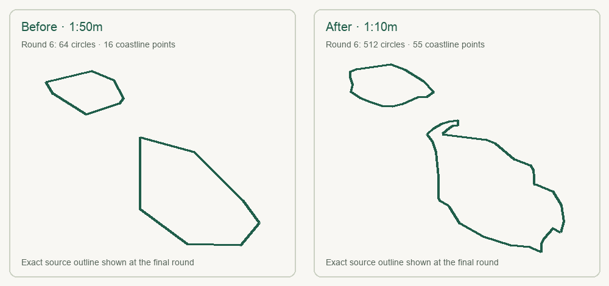

# Country drawing audit

Updated October 23, 2026 (America/New_York).

The playable pool remains the frozen set of 189 country IDs. All generated outlines now use the pinned Natural Earth 5.1.2 **1:10m** country source. Its SHA-256 is recorded in `source/manifest.json`; the earlier 1:50m source remains in `source/` for comparison. Malta's retained outline grew from 16 to 55 source vertices. The last round now uses 512 Fourier circles for Malta instead of 64. The small "N" in the puzzle was a north marker; the interface now says "↑ NORTH".

The generated polygons are simplified below display-pixel scale, retain at least 99.5% of the chosen focus region's exterior area, and keep independent Fourier chains for islands. The final round allocates at least one rotating term to every retained chain and chooses 128–1,024 total circles according to sampled RMS and boundary-distance targets (up to 511 if a single chain contains all available terms). Where the Fourier curve still differs from the source outline beyond the strict threshold, the game labels its exact source-outline display. This distinction matters: a visible source outline is not a claim that the rotating circles reproduce every coastline vertex exactly.

Focused regions keep distant islands from shrinking the puzzle: mainland Ecuador, the main island of Mauritius, the central Seychelles, and Funafuti atoll for Tuvalu. Their omitted areas are named in `scripts/overrides.json` and in each generated geometry's `note`. The game continues to use the existing focus regions for the United States, France, Norway, New Zealand, the Netherlands, and Portugal. Tuvalu's old final outline occupied only 79 painted pixels in the calibration preview; the focused version occupies 945.

The repeatable audit checks:

- Each of the 189 IDs has exactly one country index entry, geometry asset, and calibration report. The index order and daily schedule remain unchanged.
- Every stored exterior ring and Fourier coefficient matches a fresh calculation from the pinned source within serialization tolerance. Every retained chain has a final-round Fourier term.
- Browser rendering draws every country at all six stages: 1,134 nonblank canvases, with no asset request errors. The smallest first-stage drawing exceeds 100 painted pixels; the smallest final-stage drawing exceeds 350 in the 1280px calibration view.
- The production build and desktop/mobile gameplay checks validate loading, guessing, assistance, and rendering. The full audit runs on each GitHub push before Render deploys.

Manual contact-sheet review covered every final source outline, with closer review of Malta, Tuvalu, Seychelles, Mauritius, Ecuador, Canada, Chile, and other island-heavy countries. Geometry checks establish drawing consistency with this cartographic source; they do not measure how easily people recognize each country. Natural Earth still generalizes very small countries such as Monaco, Nauru, and San Marino even at 1:10m, and the game does not present these boundaries as authoritative political maps.
